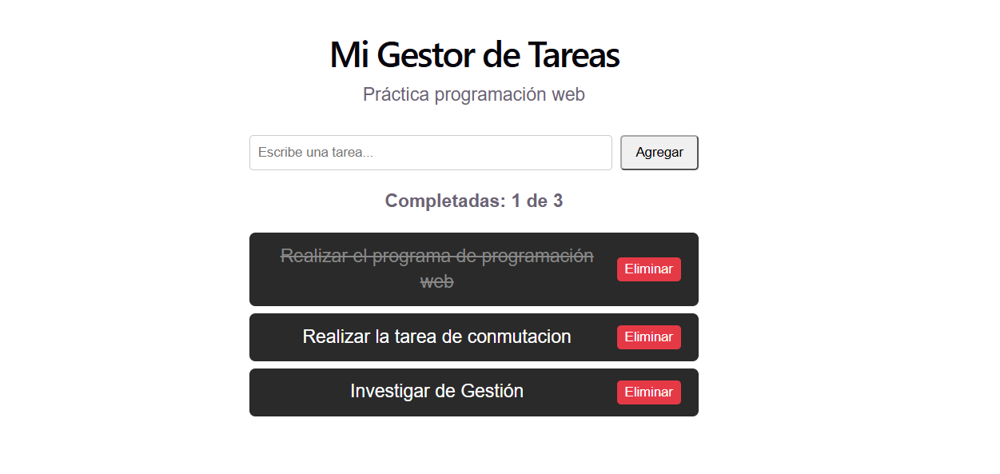

# t3_act4_react: Mi Primera App en React

Aplicación básica de gestión de tareas desarrollada con React y Vite para la práctica de conceptos fundamentales: componentes funcionales, paso de propiedades (`props`), manejo del estado (`useState`), eventos y renderizado de listas dinámicas.

---

## Preguntas y Respuestas

### a) ¿Qué diferencia hay entre props y state en React?
* **Props (Properties):** Son valores que se transmiten de un componente padre a un componente hijo. Este no puede modificar los datos, solo puede "mandar a llamarlos" y renderizarlos.
* **State (Estado):** Es información que puedes duplicarla e interna osea dentro del propio componente, asi cuando el estado cambia por medio de una funcion de actualización (como lo es `setTasks`), react re-renderiza el componente para reflejar los cambios en la pantalla sin necesidad de refrescar toda la paguina, y tambien puedes tener multiples en diferentes estados, por ejemplo, si tienes un componente el cual incrementa un numero y lo muestra en pantalla, con state puedes tener dos componentes en pantalla (llamando al mismo) en el que uno haya incrementado a 10 y el otro a 15

### b) ¿Por qué es importante usar una key al renderizar una lista de elementos?
La propiedad `key` le proporciona a React un identificador único y estable para cada elemento del DOM virtual. Esto permite que el algoritmo de reconciliación (*diffing*) identifique con precisión qué elemento específico fue agregado, modificado o eliminado sin tener que volver a crear toda la lista completa en el DOM, mejorando el rendimiento y evitando errores visuales con componentes con estado.

### c) Explica con tus propias palabras qué hace la función useState y da un ejemplo de dónde la usaste en tu mini aplicación.
`useState` es un Hook de React que permite añadir y controlar variables de estado dentro de componentes funcionales. Al llamarlo, devuelve un arreglo con dos elementos: el valor actual del estado y una función para actualizarlo y disparar un nuevo renderizado.
* **Ejemplo en la app:** Se utilizó `const [tasks, setTasks] = useState([...])` para almacenar el arreglo de tareas. Cada vez que el usuario escribe y presiona "Agregar", se llama a `setTasks([...tasks, newTask])`, lo cual actualiza la lista y redibuja la interfaz al instante.

### d) Enlace al repositorio de GitHub:
**[enlace al repositorio](https://github.com/Fredy3121/t3_act4_react)**

### e) Enlace al proyecto desplegado en GitHub Pages:
`https://fredy3121.github.io/t3_act4_react/`
